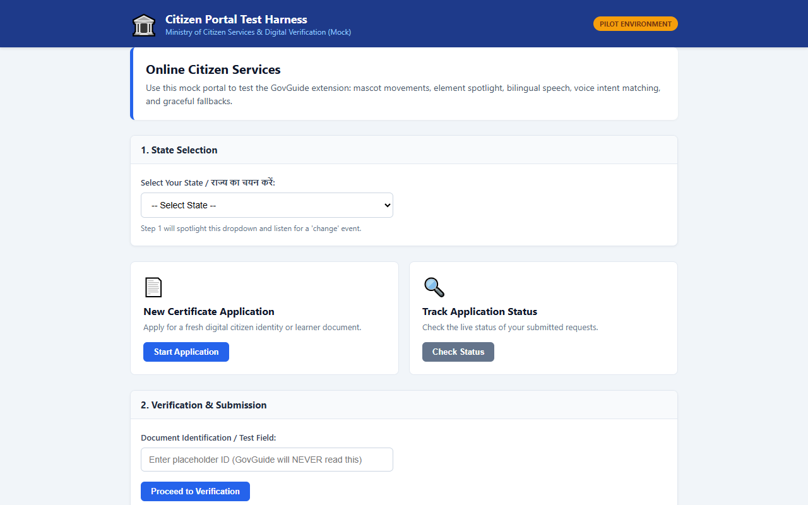
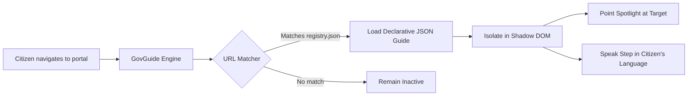

# [PROJECT NAME] (GovGuide) 🧭

> **A friendly visual guide and on-screen companion for citizens navigating complex Indian government portals.**

> [!NOTE]
> **Independent project, not affiliated with any government body.**  
> GovGuide is an independent, open-source educational helper. It is not affiliated with, endorsed by, or associated with the Government of India, the Ministry of Road Transport and Highways (MoRTH), the Ministry of External Affairs (MEA), NIC, or any state transport department.

[](#)

---

## 📑 Table of Contents

1. [What is this?](#-what-is-this)
2. [Demo & Screenshots](#-demo--screenshots)
3. [Features](#-features)
4. [Supported Websites](#-supported-websites)
5. [Languages](#-languages)
6. [Quick Start for Users](#-quick-start-for-users)
7. [Privacy Promise](#-privacy-promise)
8. [How It Works](#-how-it-works)
9. [Contributing](#-contributing)
10. [Known Limitations](#-known-limitations)
11. [Roadmap](#-roadmap-not-built-yet)
12. [Disclaimer & Trademark Note](#-disclaimer--trademark-note)
13. [License](#-license)

---

## 💡 What is this?

Most Indian government portals are built with dense administrative menus, nested dropdowns, and legacy layouts that feel intimidating unless you use them every day. Ordinary citizens applying for a learner's licence or checking passport documents often struggle to figure out which link applies to them, what pop-ups mean, or where to click next.

**[PROJECT NAME] (GovGuide)** is a lightweight Google Chrome extension that adds an on-screen companion mascot to supported official portals. The mascot moves alongside you, points directly at the button or dropdown you need with an animated spotlight, explains what to do in clear words, and speaks instructions aloud in your preferred Indian language. It never takes over your browser and never enters data for you—you stay in complete control while having a friendly helper guide the way.

---

## 📸 Demo & Screenshots

Here is GovGuide running on the built-in offline demonstration environment:

### Spotlight & Guidance

*Figure 1: The companion points at the target element, dims the background with an SVG spotlight, and provides bilingual instructions.*

### Quick-Reply Context & Questions

*Figure 2: Citizens can click one-click quick-reply chips ("What is this page?", "Documents?", "I'm stuck", "What's next?") to hear explanations.*

> *Additional demo recordings planned for live portal sessions: `docs/images/sarathi-flow.gif` and `docs/images/passport-flow.gif`.*

---

## ✨ Features

### 🧭 Visual Guidance
- **Animated Spotlight & Target Ring:** Gently highlights the required button, dropdown, or card with an SVG cutout and soft pulsating ring (`pointer-events: none`).
- **Interactive Mascot Poses:** Companion displays 5 distinct emotions: `idle` (floating bob), `pointing` (alert focus), `thinking` (during queries or inactivity), `happy` (celebration bounce on step done), and `confused` (puzzled tilt if an element cannot be found).
- **Non-Covering Speech Bubble:** Speech bubble dynamically computes placement relative to the mascot and target element, guaranteeing it never blocks the form element you need to see.
- **Draggable:** Click and drag the mascot anywhere on the screen with mouse or touch. Its position is remembered across page navigations.
- **Inactivity Nudges:** If you remain on a screen for ~20 seconds without moving forward, the companion offers a polite nudge to keep you moving (can be toggled in settings).

### 🗣️ Rich Help & Context
- **Quick-Reply Chips:** One-click shortcuts at the base of the speech bubble: *"What is this page?"*, *"What documents do I need?"*, *"I'm stuck"*, *"What's next?"*, and *"Say it again"*.
- **Document Checklist Drawer:** Collapsible checklist of required paperwork derived from the guide; checkbox tick states are remembered locally per workflow.
- **Explain-This-Field Mode:** Click the search icon (`🔍`) in the bubble header, then click any form field or label to hear an explanation of what it requires without GovGuide reading what you type.

### 🎙️ Voice Engine
- **Local Web Speech Synthesis:** Runs 100% locally on your computer with zero audio data transmitted to external servers.
- **Natural Voice Ranking:** Automatically detects and prioritizes installed Indian-English natural and neural voices (e.g. Neerja, Heera, Veena, or Google India English).
- **Conversational Spoken Scripts:** Guides feature spoken scripts written in warm, gentle Indian-English phrasing.
- **Voice Audition & Speed:** Change playback speed (0.85x, 1.0x, 1.2x), test voices, or mute voice reading anytime.
- **Pre-recorded Audio Fallback Architecture:** Supports playing bundled human audio if available, falling back to local TTS.

### 🌐 Multilingual Accessibility
- **11 Indian Languages:** Built-in UI and guide translations for English, Hindi, Marathi, Gujarati, Bengali, Tamil, Telugu, Kannada, Malayalam, Punjabi, and Odia.
- **Transparent Translation Warnings:** Unreviewed machine translations show an unobtrusive notification badge in the bubble so citizens know native speaker verification is pending.
- **Preserved Portal Terms:** Official portal buttons (such as *"Apply for Learner Licence"*, *"Continue"*, or *"Submit"*) are retained in English within translated sentences so users can visually match on-screen text.

### ♿ Accessibility & Theme
- **Theme Auto-Detection:** Automatically switches between clean Light and high-contrast Dark themes based on your system setting (`prefers-color-scheme`).
- **Text Size Cycling:** Switch between Small (13.5px), Medium (15px), and Large (17.5px) text.
- **Reduced Motion Support:** Complies with `prefers-reduced-motion: reduce` by disabling floating, pulsing, and bouncing animations.
- **Keyboard Reachable:** Visible focus outlines (`:focus-visible`) and ARIA live regions for screen readers.

### 🔒 Privacy by Architecture
- **Zero Form Value Reading:** GovGuide never reads, inspects, or logs `element.value`.
- **Zero Runtime Network Calls:** The extension makes 0 external network requests.
- **Shadow DOM Isolation:** Everything mounts inside `#govguide-root-host`, keeping extension styles isolated from government web pages.

---

## 🏛️ Supported Websites

| Portal | Scope Covered | Verified Scope | Status | Guide Reference |
|---|---|---|:---:|---|
| **Parivahan Sarathi** (`sarathi.parivahan.gov.in`) | State Selection, Contactless Modal, State Dashboard, LL Instructions, Applicant Category, eKYC selection, Stages Overview | **Delhi only** (verified) | Active ✅ | [`guides/parivahan/sarathi-ll.json`](guides/parivahan/sarathi-ll.json) |
| **Passport Seva** (`passportindia.gov.in`) | Homepage Advisory Popup, Central Services Hub, Fee Calculator landing, Document Advisor landing, Locate PSK, Application Status tracking | **Public advisory pages only** (verified) | Active ✅ | [`guides/passportseva/passportseva-main.json`](guides/passportseva/passportseva-main.json) |

*Note: Unreached screens and authenticated citizen dashboards (such as entering personal registration details or confidential Aadhaar numbers) remain explain-only boundaries.*

---

## 🌐 Languages

| Language | Native Name | Code | Review Status |
|---|---|:---:|:---:|
| **English** | English | `en` | **Reviewed** ✅ |
| **Hindi** | हिन्दी | `hi` | **Reviewed** ✅ |
| **Marathi** | मराठी | `mr` | Not yet reviewed (Machine translation) ⚠️ |
| **Gujarati** | ગુજરાતી | `gu` | Not yet reviewed (Machine translation) ⚠️ |
| **Bengali** | বাংলা | `bn` | Not yet reviewed (Machine translation) ⚠️ |
| **Tamil** | தமிழ் | `ta` | Not yet reviewed (Machine translation) ⚠️ |
| **Telugu** | తెలుగు | `te` | Not yet reviewed (Machine translation) ⚠️ |
| **Kannada** | ಕನ್ನಡ | `kn` | Not yet reviewed (Machine translation) ⚠️ |
| **Malayalam** | മലയാളം | `ml` | Not yet reviewed (Machine translation) ⚠️ |
| **Punjabi** | ਪੰਜਾਬੀ | `pa` | Not yet reviewed (Machine translation) ⚠️ |
| **Odia** | ଓଡ଼ିଆ | `or` | Not yet reviewed (Machine translation) ⚠️ |

---

## 🚀 Quick Start for Users

Because GovGuide is an open-source development project not yet on the Chrome Web Store, you install it directly in Developer Mode:

### Step 1: Download or Clone
Download this repository to your computer:
```bash
git clone https://github.com/Darshaannn/GovtSathi.git
```
*(Or click **Code &rarr; Download ZIP** on GitHub and unzip it to a folder).*

### Step 2: Load into Chrome or Edge
1. Open Google Chrome (or Microsoft Edge).
2. In the address bar, enter `chrome://extensions` (or `edge://extensions`).
3. Turn ON the **Developer mode** toggle in the top-right corner.
4. Click the **Load unpacked** button in the top-left corner.
5. Select the `GovtSathi` folder containing `manifest.json`.

### Step 3: Open a Supported Site
- Navigate to **Parivahan Sarathi** (`https://sarathi.parivahan.gov.in/sarathiservice/stateSelection.do`) or open the built-in offline demo at `chrome-extension://<EXTENSION_ID>/demo/demo.html`.
- GovGuide will automatically detect the page and mount the companion mascot.

### Step 4: Using the Controls
- **Switch Language:** Click the language dropdown in the speech bubble header or in the extension toolbar popup.
- **Repeat Instruction:** Click the repeat icon (`🔄`) to hear the current step read again.
- **Mute Voice:** Click the speaker icon (`🔊`) to silence spoken instructions.
- **Quick Questions:** Click any chip at the bottom of the bubble (*"What is this page?"*, *"Documents?"*, etc.) to hear explanations.
- **Microphone Note (`🎤`):** Clicking the microphone allows speaking search intents. Voice recognition uses your browser vendor's recognition service; a one-time privacy consent notice is shown before the mic can be used.
- **Minimize or Turn Off:** Click the minimize dash (`—`) in the bubble header to collapse the mascot into a discreet floating restore button. To disable completely, toggle the extension off in `chrome://extensions`.

---

## 🔒 Privacy Promise

GovGuide was created with a fundamental rule: **We do not want your personal information.**

1. **Zero Form Field Reads:** GovGuide never attaches listeners that read what you type. It does not inspect `element.value`.
2. **Zero Aadhaar, Password, or OTP Access:** Sensitive identity and security fields are automatically classified as secure areas. GovGuide displays a reminder notice and never interacts with them.
3. **No External Network Calls:** The runtime extension makes zero API requests, zero analytics calls, and zero external script downloads.
4. **Local Storage Only:** Local browser storage (`chrome.storage.local`) saves only your interface preferences (language, speech speed, text size, nudge toggle, mascot screen coordinates, and document checklist ticks).
5. **Microphone Privacy:** The experimental voice search feature requires explicit one-time consent because speech recognition runs through the browser's speech service.

For a permission-by-permission breakdown, see [docs/permissions-and-privacy.md](docs/permissions-and-privacy.md).

---

## ⚙️ How It Works

GovGuide separates portal logic from extension code:
- The **Core Engine** handles the Shadow DOM container, speech bubble positioning, floating mascot animations, and Web Speech API synthesis.
- Pure **JSON Guides** define page URLs, CSS selector targets, and multilingual text.



For full architectural details, see [docs/architecture.md](docs/architecture.md).

---

## 🤝 Contributing

We welcome contributions to make government portals accessible to everyone!

- **Native Speakers Wanted:** 9 of our 11 languages are awaiting native speaker review. Check [docs/adding-a-language.md](docs/adding-a-language.md) to help refine translations.
- **Write a Guide:** Help add new portals or flows by following [docs/writing-a-guide.md](docs/writing-a-guide.md).
- **Mascot Art:** Designers can review the 5 required poses in [docs/mascot.md](docs/mascot.md).
- **Safety Rule for Contributors:** **NEVER submit captures, HTML files, or screenshots containing real citizen personal data.**

Please review [CONTRIBUTING.md](CONTRIBUTING.md) and our [CODE_OF_CONDUCT.md](CODE_OF_CONDUCT.md) before opening a pull request.

---

## ⚠️ Known Limitations

We believe in being 100% upfront about what is currently built:

1. **Sarathi Scope:** Parivahan Sarathi guidance is verified **only for Delhi**. Other states have different portal workflows, authentication steps, and fees that have not yet been mapped.
2. **Passport Seva Scope:** Passport Seva guidance is verified **only for public landing pages** (Fee Calculator, Document Advisor, PSK Locator, Status Tracking, and Advisory notices). Authenticated user forms and appointments are explain-only placeholders.
3. **Language Reviews:** Only English and Hindi have been fully reviewed by native speakers. The other 9 languages are machine translations.
4. **Pre-recorded Audio:** The engine supports playing pre-recorded audio files (`step.audio`), but **no pre-recorded MP3 audio files are bundled** in the repository. It currently relies on browser Text-to-Speech (TTS).
5. **Placeholder Mascot:** The current mascot graphic (`assets/mascot-default.svg`) is a temporary placeholder owl character with CSS-driven expressions.
6. **Store Availability:** GovGuide is not yet published on the Chrome Web Store and must be loaded unpacked in developer mode.

---

## 🗺️ Roadmap (Not Built Yet)

- [ ] Native speaker review and verification for all 9 remaining languages.
- [ ] Expansion of Parivahan Sarathi guide beyond Delhi to other states (e.g. Maharashtra, Uttar Pradesh, Karnataka).
- [ ] Bundled high-quality offline audio recordings for core workflow steps.
- [ ] Production-grade illustrated mascot character with custom SVG art assets for all 5 expression states.
- [ ] Submission and publication on the Chrome Web Store and Edge Add-ons catalog.

---

## ⚖️ Disclaimer & Trademark Note

- **Not a Government Product:** GovGuide is an independent helper project. It is not an official government application and does not represent any government agency.
- **No Official Emblems:** GovGuide does not use official emblems, government crests, or protected seals.
- **Portal Changes:** Indian government portals frequently update their HTML layouts and URLs. When a portal layout changes, selectors may break until a contributor updates the corresponding guide JSON file. Please report broken layouts via our [Issue Tracker](.github/ISSUE_TEMPLATE/guide-broke.yml).

---

## 📄 License

TODO: owner to choose a licence
