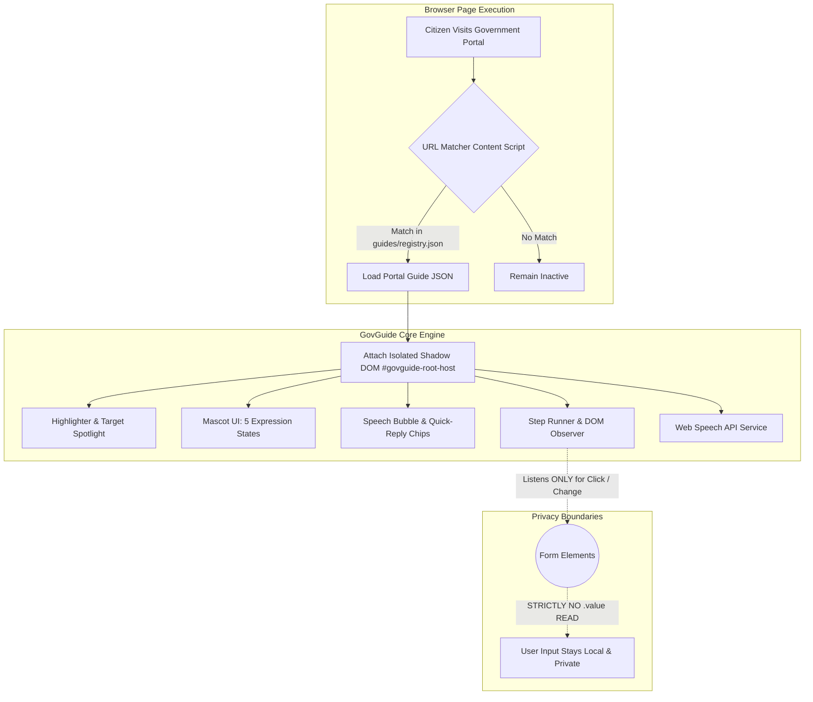

# Architecture & Engineering Overview

GovGuide is built as a lightweight, privacy-first **Chrome Extension Manifest V3 (MV3)**. It is structured into two completely decoupled layers:

1. **A Portal-Agnostic Core Engine** (`engine/`): Handles UI rendering, Shadow DOM encapsulation, element detection, multi-language speech, and user interaction.
2. **Declarative Guide Schemas** (`guides/`): Pure JSON files defining URLs, matching rules, elements to highlight, and translated explanations.

---

## 1. Directory Structure

- **`manifest.json`**: Chrome Extension Manifest V3 configuration declaring content scripts, popup, and permissions (`storage`).
- **`engine/shadow-dom.js`**: Mounts a single, isolated Shadow Root (`#govguide-root-host`) at `z-index: 2147483640`. Guarantees portal CSS never leaks into the guide UI and extension styles never disrupt government portals.
- **`engine/highlighter.js`**: Renders an SVG cutout spotlight and animated CSS pulse ring over the target element (`pointer-events: none`).
- **`engine/element-finder.js`**: Multi-tier selector resolution engine (ID &rarr; CSS selector &rarr; textMatch &rarr; relative container).
- **`engine/mascot-ui.js`**: Renders the SVG mascot companion, supporting 5 distinct expression states (`idle`, `pointing`, `thinking`, `happy`, `confused`), mouse/touch dragging, and smooth easing.
- **`engine/speech-bubble.js`**: Renders the speech bubble with collision avoidance, quick-reply chips bar, document checklist drawer, and text-size cycling.
- **`engine/speech-service.js`**: Thin wrapper over browser `window.speechSynthesis`. Handles voice ranking, custom speech rates, polite sentence trimming, and optional audio playback.
- **`engine/step-runner.js`**: State machine managing flows, page matching, step progression, inactivity nudges, and Explain-This-Field event handling.
- **`engine/content-script.js`**: Top-frame bootstrapper that checks the URL against `guides/registry.json` and initializes the engine.
- **`popup/`**: Chrome action popup for user language selection, voice auditioning, speech rate adjustments, and inactivity nudge toggling.
